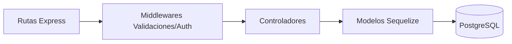

# ⚙️ RestoYa - Backend (Node.js & Express)

Este es el **Backend** del sistema de restaurante y delivery "RestoYa", desarrollado con **Node.js, Express y PostgreSQL (Sequelize)**. Implementa el patrón arquitectónico MVC, altas protecciones de seguridad, validaciones de servidor, y consumo e integración nativa de **APIs de terceros**.

---

## 🎯 Objetivos del Proyecto
Cumplir con todos los requisitos técnicos de **Programación y Servicios Web (UNJu)**, desarrollando una API RESTful robusta, documentada y segura, capaz de manejar roles, transacciones comerciales y reportería.

## 🛠️ Tecnología Aplicada
- **Servidor:** Node.js v18+ con Express.js.
- **Base de Datos:** PostgreSQL en la nube.
- **ORM:** Sequelize (Sincronización automática de modelos).
- **Seguridad:** JWT, Bcryptjs, Helmet, Express-Rate-Limit.
- **Documentación:** Swagger (OpenAPI).
- **Reportes:** PDFKit, ExcelJS.

---

## 🏗️ Arquitectura (MVC)

El proyecto está estrictamente dividido en capas para garantizar la escalabilidad:



---

## 📂 Estructura de Carpetas

```text
/
 ├── config/             # Configuración de BD, Swagger y Semillas (Seeders)
 ├── src/
 │   ├── controllers/    # Lógica de negocio (Login, Pedidos, Productos, Caja)
 │   ├── middlewares/    # Interceptores (Auth con JWT, Validaciones Express-Validator)
 │   ├── models/         # Definición de Tablas y Relaciones (Sequelize)
 │   └── routes/         # Definición de Endpoints HTTP (GET/POST/PUT/DELETE)
 ├── index.js            # Punto de entrada de la aplicación
 └── package.json        # Dependencias NPM
```

---

## 🔌 APIs Externas Integradas (Backend)

1. **MercadoPago SDK (`mercadopago`):** 
   - **Integración:** El controlador `pago.controller.js` se comunica con MP para generar Preferencias de Pago. 
   - **Webhooks:** Contamos con un endpoint específico (`POST /api/pagos/webhook`) que recibe las notificaciones de pago asíncronas de MP, registra el ingreso en la Caja, y actualiza el estado del pedido automáticamente usando Transacciones SQL.
2. **Google Auth Library (`google-auth-library`):** 
   - **Integración:** El controlador `login.controller.js` verifica criptográficamente los tokens enviados por el frontend contra los servidores de Google usando nuestro `GOOGLE_CLIENT_ID`. Si es válido, extrae nombre, apellido y correo para crear/loguear al usuario en nuestra BD.
3. **Email API (`nodemailer`):** 
   - **Integración:** Servicio para notificaciones vía correo electrónico a los usuarios.
4. **Chatbot API:** 
   - **Integración:** Respuestas automatizadas para atención al cliente y asistencia en la navegación del menú.
5. **Open-Meteo API (Clima en tiempo real):**
   - **Integración:** El frontend consume esta API pública para obtener el estado del clima actual. Si detecta lluvia, el sistema muestra automáticamente una alerta a los clientes indicando posibles demoras en el Delivery.

---

## 🛡️ Mecanismos de Seguridad Implementados

Para garantizar la máxima protección de los datos, se implementó:
- **Helmet:** Oculta cabeceras de Express y configura políticas de seguridad HTTP.
- **Express-Rate-Limit:** Previene ataques de fuerza bruta limitando los intentos de Login por IP a 10 cada 15 minutos.
- **Express-Validator:** Validación estricta del lado del servidor. Se previenen Inyecciones SQL y envíos de datos corruptos antes de que toquen el Controlador.
- **Bcrypt:** Hasheo de contraseñas de los usuarios. Ninguna clave se guarda en texto plano.
- **JWT (JSON Web Tokens):** Las rutas privadas exigen un token válido firmado con un secreto asimétrico.
- **Auditoría e Historial:** Se creó el modelo `Historial` que registra automáticamente cada inicio de sesión exitoso, almacenando el ID de usuario, la IP, el método (Email/Google) y la fecha/hora exacta.

---

## 📍 Rutas de la API (Endpoints)

La documentación interactiva completa puede probarse levantando el servidor e ingresando a: **`http://localhost:3000/api-docs`** (Swagger).

### Autenticación (`/api/auth`)
| Método | Ruta | Descripción | Acceso |
|---|---|---|---|
| POST | `/login` | Inicia sesión y devuelve JWT | Público |
| POST | `/google` | Inicia sesión con token de Google OAuth | Público |

### Usuarios (`/api/usuarios`)
| Método | Ruta | Descripción | Acceso |
|---|---|---|---|
| GET | `/` | Lista todos los usuarios | Gerente |
| POST | `/` | Crea un nuevo usuario | Gerente |
| PUT | `/:id` | Modifica un usuario existente | Gerente |
| DELETE | `/:id` | Elimina un usuario | Gerente |

### Productos (`/api/productos`)
| Método | Ruta | Descripción | Acceso |
|---|---|---|---|
| GET | `/` | Lista el menú | Público |
| GET | `/:id` | Obtiene un producto por ID | Público |
| POST | `/` | Agrega un nuevo producto | Gerente |
| PUT | `/:id` | Edita precio/datos del producto | Gerente |
| DELETE | `/:id` | Borra un producto del menú | Gerente |

### Mesas (`/api/mesas`)
| Método | Ruta | Descripción | Acceso |
|---|---|---|---|
| GET | `/` | Lista las mesas y sus estados | Gerente, Mozo |
| PUT | `/:id/estado` | Cambia el estado (LIBRE/OCUPADA) | Gerente, Mozo |

### Pedidos (`/api/pedidos`)
| Método | Ruta | Descripción | Acceso |
|---|---|---|---|
| POST | `/` | Crea un pedido (Local o Delivery) | Mozo, Cliente |
| GET | `/` | Lista los pedidos | Gerente, Cajero |
| PUT | `/:id/estado` | Cambia el estado del pedido | Gerente, Cocina |

### Caja (`/api/pagos` y `/api/reportes`)
| Método | Ruta | Descripción | Acceso |
|---|---|---|---|
| POST | `/api/pagos` | Registra un cobro (Efectivo/MercadoPago) | Cajero |
| GET | `/api/reportes/caja/:id/pdf` | Genera el reporte PDF del turno | Cajero, Gerente |
| GET | `/api/reportes/caja/:id/excel` | Exporta la recaudación a Excel | Cajero, Gerente |

### Cocina (`/api/cocina`)
| Método | Ruta | Descripción | Acceso |
|---|---|---|---|
| GET | `/items-pendientes` | Lista **exclusivamente platos y postres** por preparar (filtra bebidas) | Cocina, Gerente |
| PUT | `/marcar-listo/:id` | Cambia a "LISTO_PARA_ENTREGA" un item | Cocina, Gerente |

---
*Desarrollado para la cátedra Programación y Servicios Web - UNJu*
